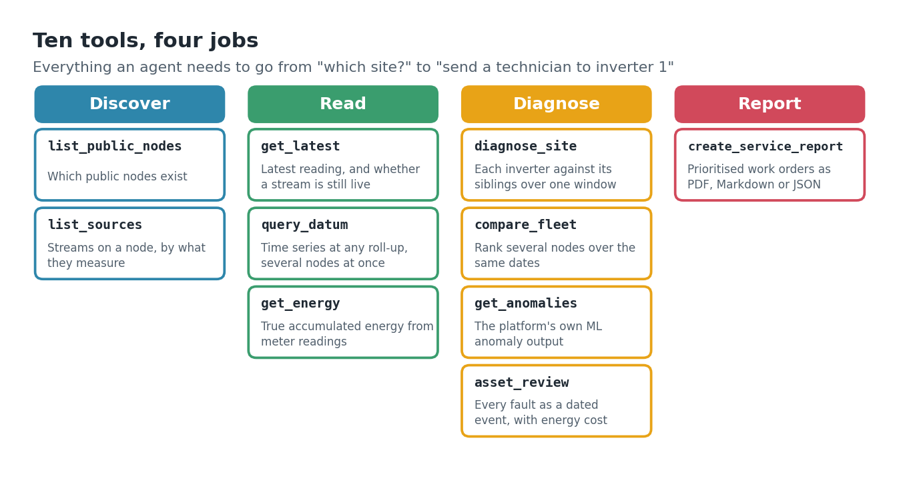
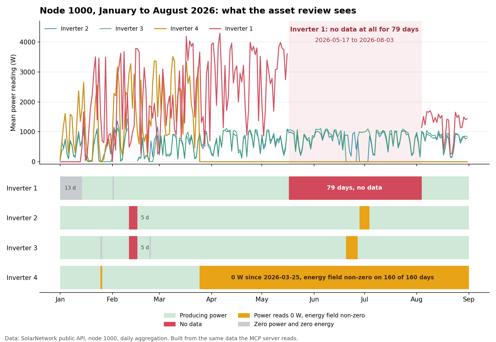
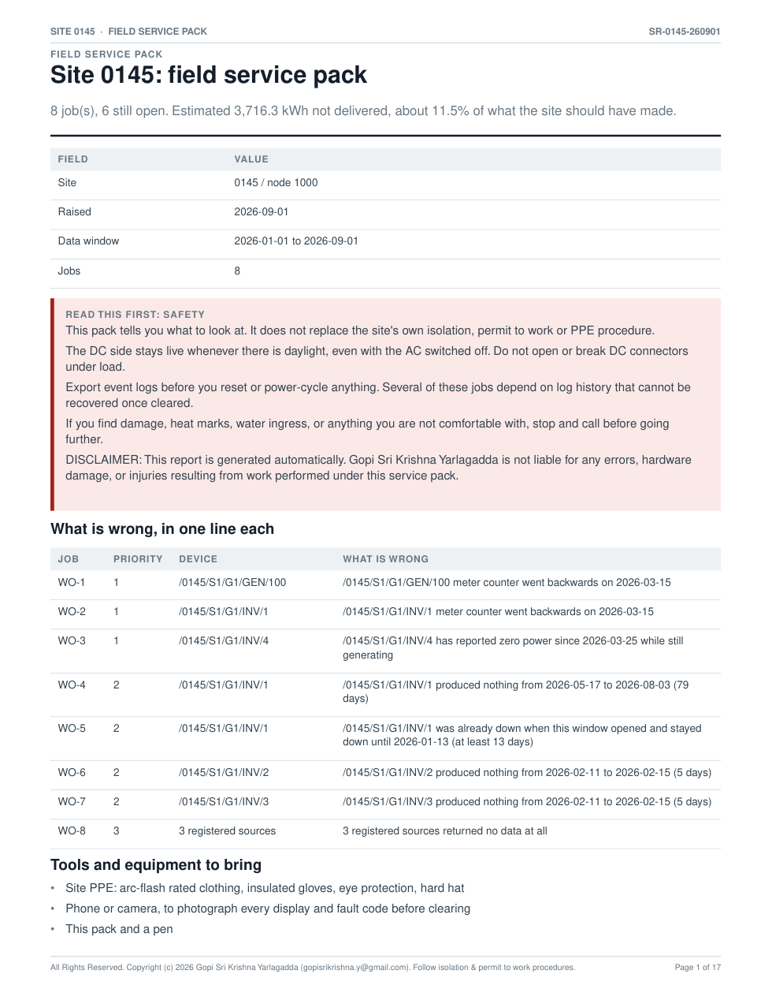
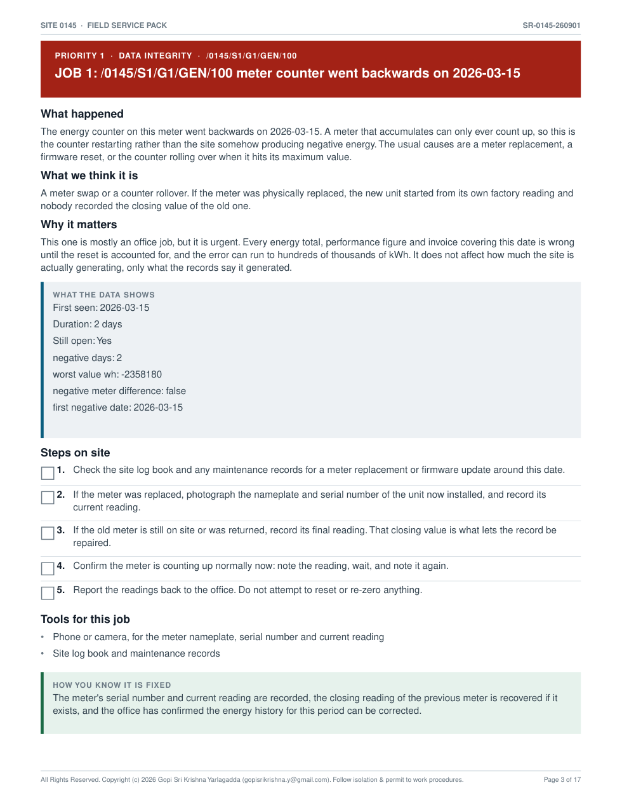
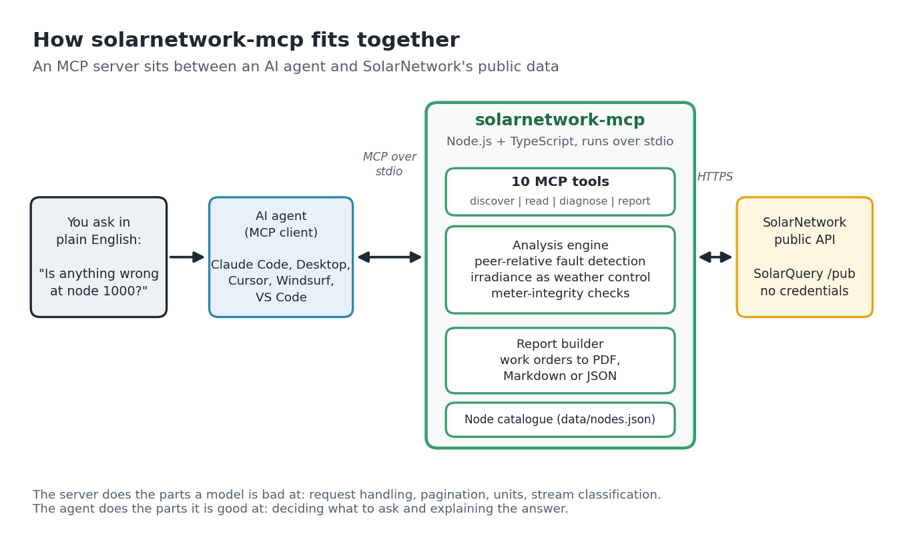

# solarnetwork-mcp

An [MCP](https://modelcontextprotocol.io) server that turns SolarNetwork solar
telemetry into tools an AI agent can call.

**No credentials required.** It runs against SolarNetwork's public endpoints,
where **567 nodes publish data**. That is from a re-check of node IDs 1 to 5000 on
2026-10-15; the first full sweep of IDs 1 to 12000 on 2026-08-25 found 556 (see
[NODES.md](NODES.md)). Of the 567, 336 have generation, inverter or irradiance streams
this server can classify, 288 of those reported in the last 24 hours, and 205 have two
or more inverters, which is what fault detection needs. Several update to the minute, and
the core US fleet (nodes 880 to 1000) has nearly seven years of history.

**Verified 2026-10-15:** `npm run verify` passes 28 of 28 checks against live data.

## What it can do

**Read solar telemetry**
- Discover public nodes with no credentials, filter by timezone or liveness
- Classify every stream on a site: site meter, inverter, irradiance, weather, ML anomaly
- Query time series at any roll-up from five minutes to a year
- Get true accumulated energy from meter readings rather than averaged power
- Check whether a stream is still alive, by timestamp rather than by value

**Find equipment faults, with dates**
- Detect inverter outages and pin the exact start and end day
- Distinguish a dead device from one that is generating but not reporting power
- Catch a device that has gone silent while its siblings keep reporting
- Flag meter counter resets, which silently corrupt every energy total spanning them
- Spot registry entries for hardware that has never existed
- Estimate energy lost per fault, scaled from sibling output by each device's own capacity

**Not raise false alarms**
- Detection is peer-relative, so cloud cover cannot register as a fault
- Irradiance is used as a physical weather control where a pyranometer exists
- Faults already running when the window opens are labelled as lower bounds, not invented start dates
- Sites that cannot be assessed are reported as *not assessed*, never as healthy

**Write reports people can act on**
- Prioritised work orders with plain-language cause, evidence, numbered steps, tools and sign-off criteria
- Printable PDF field packs with tick boxes and a notes sheet
- Markdown for pasting into a ticket, or JSON to post-process
- Plain ASCII throughout, so nothing turns into black boxes in a PDF or a ticketing system

## What it cannot do

Worth knowing before you rely on it:

- **Sites with fewer than two inverters cannot be assessed.** Peer comparison needs peers. The tool says so rather than reporting a clean result.
- **No nameplate ratings.** Public nodes do not expose them, so loss figures are peer-scaled estimates, not warranty calculations.
- **Fault detection runs on daily buckets.** A device silent for six hours is invisible.
- **Stream classification depends on a path convention.** Sites naming streams `Main` or `SMAInverter1` come back unclassified.

## What it actually does

Without it, answering *"is anything wrong at this site?"* means knowing the node
ID, the `/datum/list` endpoint, that `aggregation=Day` exists, that `watts` and
`wattHours` are different questions, and then reading JSON.

With it, you ask:

> **"Is anything wrong at node 1000? If output is down, tell me whether it's weather or equipment."**

and the agent discovers the site's streams, picks a date range, runs the
aggregation, compares each inverter against its siblings, and answers in
English. One sentence in, a diagnosis out.

The server does the parts a language model is bad at — request signing,
pagination, unit semantics, knowing which of nine streams is a weather sensor.
The agent does the parts it's good at — deciding what to ask and interpreting
the answer.

## See it working in 60 seconds

```bash
npm install && npm run build && npm run smoke
```

That drives every tool over the real MCP protocol against live data. No agent,
no API key, no config. If it prints findings for node 1000, you're good.

## Hand this to your agent

Copy the whole block below into Claude Code, Cursor, or any MCP-capable agent.
It installs the server, wires itself up, proves the install works, and then runs
a guided demo of every capability against live public solar sites.

```text
Set up and demo the solarnetwork MCP server for me.

1. INSTALL
   git clone https://github.com/gopisrikrishna/solarnetwork-mcp.git
   cd solarnetwork-mcp
   npm install
   npm run build

2. VERIFY THE INSTALL
   Run: npm run verify
   This runs 28 assertions against live public solar data. No credentials needed.
   Tell me how many passed. If any fail, show me which and stop.

3. CONNECT IT
   Register the server with yourself over stdio:
     command: node
     args:    ./dist/index.js   (run from the solarnetwork-mcp directory)
   The repo ships a .mcp.json that already does this. Restart/reconnect if your
   client needs it, then confirm you can see 10 tools and list their names.

4. DEMO IT
   Work through these against real public nodes and show me what you find.
   Explain your reasoning at each step, do not just dump JSON.

   a) DISCOVERY
      Which public nodes are live in US timezones? Then: what does node 1000
      measure, and how far back does its data go?

   b) ENERGY
      How much did node 1000 generate in July 2026? Use the right tool for a
      billing-shaped question and tell me why you chose it.

   c) FAULT DETECTION  <- the interesting one
      Run an asset review on node 1000 for 2026-01-01 to 2026-09-01.
      Tell me what broke, exactly when it started and ended, and what it cost.
      There is a real 79-day inverter outage in there, and a second fault where
      a device reports 0 watts while still generating. Explain the difference
      between those two failure modes and why it matters.

   d) NOT BEING FOOLED
      Run an asset review on node 949 for July 2026. It will find nothing.
      Explain why "no faults found" does NOT mean the site is healthy here.

   e) DATA INTEGRITY
      Run an asset review on node 781 for 2026-01-01 to 2026-09-01.
      Its site meter counter reset mid-year. Show me how the tool handles it and
      what would have gone wrong without that handling.

   f) CROSS-CHECK
      Node 392 publishes the platform's own ML anomaly streams. Compare what
      get_anomalies says against what the asset review found. Do they agree?

   g) REPORT
      Generate a PDF service report for node 1000 over the same window, written
      for an on-site technician. Save it and tell me the path, how many pages,
      and summarise the priority 1 jobs.

5. WRAP UP
   Tell me in plain language: what is wrong with node 1000, how much energy has
   been lost, and what you would send a technician to do first.
```

## Verify it yourself

Because it runs on public data, you do not have to take any of its conclusions
on trust. Every finding is independently reproducible from your own machine:

```bash
npm install && npm run build && npm run verify
```

28 assertions against fixed historical windows on live public nodes. No
credentials. Among them:

| Check | Node | Expectation |
| --- | --- | --- |
| Fault timeline | 1000 | Inverter 1 outage, exactly 2026-05-17 to 2026-08-03, 79 days |
| Telemetry fault | 1000 | Inverter 4 reporting 0 W since 2026-03-25 while still generating |
| Pagination | 1000 | A year exceeds SolarQuery's 1000-row page cap; every row is fetched |
| Meter integrity | 781 | Counter reset raised, and site energy never reported negative |
| Meter integrity | 900 | Counter reset pinpointed to 2026-06-03 |
| Coverage honesty | 949 | A node with no inverters reports "not assessed", never "healthy" |
| Site meter choice | 464 | The real meter wins over a leftover `/TEST/GEN/1` stub |
| Report output | 1000 | Work orders, acceptance criteria, plain ASCII only |

A failure means the server regressed, or SolarNetwork restated history. Each
assertion prints what it expected against what it got, so the two are easy to
tell apart.

Last run on 2026-10-15: **28 passed, 0 failed.**

## Load it into your agent

Every client wants the same three facts: run `node`, pass it `dist/index.js`,
talk over stdio. Only the file location differs.

Use the **absolute path** to `dist/index.js` on your machine. Forward slashes
work on Windows too.

The `.mcp.json` committed here uses a relative path instead, so that anyone who
clones the repo gets a working server without editing anything. That only works
for clients that launch the server from the project root, which Claude Code
does; other clients may need the absolute form.

### Claude Code

Already configured — [`.mcp.json`](.mcp.json) is in the repo root, so a session
started in this directory picks it up automatically. Just edit the path:

```json
{
  "mcpServers": {
    "solarnetwork": {
      "command": "node",
      "args": ["/absolute/path/to/solarnetwork-mcp/dist/index.js"]
    }
  }
}
```

Or register it globally from anywhere:

```bash
claude mcp add solarnetwork -- node /absolute/path/to/solarnetwork-mcp/dist/index.js
```

### Claude Desktop

Edit `claude_desktop_config.json`:

- **macOS** — `~/Library/Application Support/Claude/claude_desktop_config.json`
- **Windows** — `%APPDATA%\Claude\claude_desktop_config.json`

```json
{
  "mcpServers": {
    "solarnetwork": {
      "command": "node",
      "args": ["/absolute/path/to/solarnetwork-mcp/dist/index.js"]
    }
  }
}
```

Restart the app. A tools icon appears in the message box.

### Cursor

`.cursor/mcp.json` in your project, or `~/.cursor/mcp.json` for every project.
Same `mcpServers` block as above.

### Windsurf

`~/.codeium/windsurf/mcp_config.json`. Same `mcpServers` block.

### VS Code (Copilot agent mode)

`.vscode/mcp.json` — note the key is `servers`, not `mcpServers`:

```json
{
  "servers": {
    "solarnetwork": {
      "type": "stdio",
      "command": "node",
      "args": ["/absolute/path/to/solarnetwork-mcp/dist/index.js"]
    }
  }
}
```

### Zed

In `settings.json`, under `context_servers`:

```json
{
  "context_servers": {
    "solarnetwork": {
      "command": { "path": "node", "args": ["/absolute/path/to/dist/index.js"] }
    }
  }
}
```

### Anything else

Any MCP client can launch it over stdio:

```bash
node /absolute/path/to/solarnetwork-mcp/dist/index.js
```

To drive it from code, [`scripts/smoke.mjs`](scripts/smoke.mjs) is a complete
worked example using the official TypeScript SDK.

### Checking it loaded

Ask your agent: *"What solar tools do you have?"* You should see ten.
If not, the usual causes are a relative path, a missing `npm run build`, or the
client not being restarted.

## The tools



**Discovery**

| Tool | Answers |
|---|---|
| `list_public_nodes` | "What nodes can I even look at?" |
| `list_sources` | "What does this node measure?" |
| `get_latest` | "What's happening right now?" |

**Data**

| Tool | Answers |
|---|---|
| `query_datum` | "Show me output over this period" |
| `get_energy` | "How many kWh did it actually generate?" |

**Analysis**

| Tool | Answers |
|---|---|
| `asset_review` | "What broke, when did it start, and what did it cost?" |
| `diagnose_site` | "Is anything wrong right now, weather or equipment?" |
| `compare_fleet` | "Which of my sites needs attention first?" |
| `get_anomalies` | "What does the platform's own ML detector say?" |

**Reporting**

| Tool | Answers |
|---|---|
| `create_service_report` | "Give me a work order I can hand to a technician" |

## Things to ask it

Start here — these are real, live nodes:

**Orientation**
> Which public SolarNetwork nodes are live in US timezones?

> What does node 1000 measure, and how far back does its data go?

**Right now**
> What's node 892 generating right now, and what's the weather there?

Node 892 carries a weather sensor and a pyranometer, so the agent gets
temperature, cloud cover and irradiance alongside output.

**Diagnosis** — the interesting ones
> Is anything wrong at node 1000?

> Node 892 lists six inverters but I see no generation. What's going on?

**Fleet**
> Rank nodes 880, 884, 953, 964, 976, 987 and 1000 by output last week. Which should I look at first?

**Multi-step**, where the chaining shows
> Find a live US node with at least four inverters and irradiance data, then diagnose it for the last two weeks.

## What you get back

Real output from `diagnose_site` on node 1000:

```
[high] reporting-gap   /0145/S1/G1/GEN/101, /102, /103
       Registered on this node but returned no data for the window. That is a
       reporting or comms outage rather than a performance problem, so the
       device may well be generating.

[low]  inconsistent-instrumentation   /0145/S1/G1/INV/4
       Reports 0 W, but its `wh` field is non-zero (peak 16508), so it is moving
       energy. This device populates energy fields only, unlike its peers, so
       power-based comparison would wrongly read it as dead.
```

That second finding is the point of the whole project. `INV/4` reads 0 W while
its three siblings produce 400–700 W, which looks exactly like a dead inverter —
and an earlier version of this tool said so. It isn't dead: its meter accumulated
826 kWh that month. Inverters at one site use different reporting conventions.
A health check keyed on `watts` alone would page someone about a working
inverter every night.

### A full review of one site

Real output from `asset_review` and `create_service_report` on node 1000, for
2026-01-01 to 2026-09-01 (run on 2026-10-15):

```
10 event(s) across 243 buckets, 6 still open at 2026-09-01.
Estimated 3716 kWh not delivered.
```

The report headline reads "8 job(s), 6 still open. Estimated 3,716.3 kWh not
delivered, about 11.5% of what the site should have made."

| Finding | Device | What the review says |
| --- | --- | --- |
| Outage | INV/1 | Produced nothing from 2026-05-17 to 2026-08-03 (79 days) while a sibling kept producing |
| Outage | INV/1 | Already down when the window opened, back on 2026-01-13 (at least 13 days) |
| Outage | INV/2, INV/3 | Both produced nothing from 2026-02-11 to 2026-02-15 (5 days) |
| Power telemetry loss | INV/4 | 0 W on every bucket since 2026-03-25 (160 days) while its energy meter advanced 7887 kWh |
| Meter counter reset | GEN/100, INV/1 | Counter went backwards on 2026-03-15 (-2,358 kWh and -37 kWh) |
| Registered, no data | GEN/101, 102, 103 | Declared in the source registry, never returned a bucket |



The chart is built from the same public daily data the server reads. The red block
is Inverter 1's 79 missing days. The amber block is Inverter 4: its power reads 0 W,
but its energy field is non-zero on every one of those days, so it is alive and only
the power reading is lost.

The PDF is a printable field pack, 17 pages for this site. Page 1 is the summary and
safety notice, and each job gets its own page with steps, tools and sign-off criteria:





## Your own nodes

Set two environment variables and the server switches from the public `/pub`
endpoints to authenticated `/sec` ones. The tool surface is unchanged:

```bash
SN_TOKEN_ID=... SN_TOKEN_SECRET=... node dist/index.js
```

Auth is SolarNetwork's SNWS2 scheme — HMAC-SHA256 over a canonicalised request
with a date-scoped key. It's implemented but **untested**; I have no token pair
to verify against.

## How it works



Six TypeScript files, about 3,200 lines:

- [`src/solarnetwork.ts`](src/solarnetwork.ts) (337 lines): API client, paging, request signing
- [`src/analysis.ts`](src/analysis.ts) (371 lines): source-ID parsing, per-site diagnosis
- [`src/assets.ts`](src/assets.ts) (708 lines): the asset-review layer, which walks each device's day-by-day record and returns dated fault events
- [`src/report.ts`](src/report.ts) (493 lines): turns a review into prioritised work orders, and renders Markdown
- [`src/pdf.ts`](src/pdf.ts) (571 lines): renders the printable PDF field pack
- [`src/index.ts`](src/index.ts) (710 lines): the ten tool definitions

The tool *descriptions* are the real interface. An agent only chains
`list_sources` → `query_datum` correctly if the descriptions say when to reach
for each one. Getting that wording right mattered more to whether this works
than any of the data handling.

## Limits

- Node metadata is empty on public nodes, so there's no nameplate capacity and
  therefore no capacity-normalised comparison. `compare_fleet` ranks raw output
  and says so — a big site will outrank a small healthy one.
- `list_public_nodes` reads a point-in-time scan ([`data/nodes.json`](data/nodes.json)),
  not a live listing. That file is the 2026-08-25 sweep of node IDs 1 to 12000, which found
  556 nodes with data ([NODES.md](NODES.md) has the method and the breakdown). A re-check on
  2026-10-15 found 567; the list, with stream counts, is in
  [`data/rescan-2026-10-15.json`](data/rescan-2026-10-15.json). Call `list_sources` to confirm
  before relying on a node.
- No caching. Repeated agent calls re-hit the API.
- No offline unit tests. `scripts/verify.mjs` runs 28 assertions against live public data, so a failure
  means either a regression or SolarNetwork restating history. `scripts/smoke.mjs` is a live probe.
- SolarQuery silently coerces fine-grained aggregation to hourly for ranges over
  ~7 days. `query_datum` passes your aggregation through as-is, so long ranges
  return coarser data than requested.

More detail: [USAGE.md](USAGE.md) for worked examples and an effort comparison,
[DATA.md](DATA.md) for the full inventory of what's public vs credential-gated.

## License

Proprietary / All Rights Reserved. See [LICENSE](LICENSE) for details.

## Disclaimer

- **No warranty.** The software and everything it produces (analysis, fault events, loss estimates, work orders,
  and PDF, Markdown or JSON reports) are provided "as is", without warranty of any kind, express or implied,
  including accuracy, completeness and fitness for a particular purpose.
- **Estimates, not engineering advice.** Fault detection is statistical and peer-relative. Loss figures are
  peer-scaled estimates, not warranty or contractual calculations. "No faults found" and "not assessed" are not
  statements that equipment is healthy or safe, and detection runs on daily buckets, so shorter events are invisible.
- **Safety.** A generated field service pack describes what to look at. It does not replace the site's own
  isolation, permit-to-work or PPE procedures, and it must only be acted on by qualified people. The DC side of
  solar equipment stays live in daylight.
- **Third-party data.** Data comes from SolarNetwork's public API and can be incomplete, delayed, restated or
  removed. Node counts in this repository are snapshots and may be wrong. This project is not affiliated with,
  endorsed by or sponsored by SolarNetwork or its operators.
- **Personal project.** This is a personal project. It is not a product, work or statement of my employer, and it
  is not affiliated with my employer.
- **Limitation of liability.** To the maximum extent permitted by law, the author is not liable for any claim,
  damages or other liability, including lost energy output or revenue, equipment damage or personal injury,
  arising from the use of, or inability to use, this software or its output.

## Credit and contact

Written by **Gopi Sri Krishna Yarlagadda**. Copyright (c) 2026 Gopi Sri Krishna Yarlagadda. All rights reserved.

Linking to this project and describing it are welcome, and so is credit: "Gopi Sri Krishna Yarlagadda,
solarnetwork-mcp, https://github.com/gopisrikrishna/solarnetwork-mcp". Using, adapting or redistributing any part of
the code or its output needs written permission first: gopisrikrishna.y@gmail.com.
